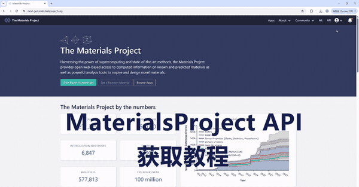

# dsh-mp-fetch

> DeepSeek Harness（DSH）的 **Materials Project 查询插件**。  
> 按化学式 / MP ID / 化学体系取空间群与物性，或按空间群+体系做普查；查询结果自动落盘。  
> **零 Python、零第三方 npm 依赖。**

---

## 功能

- `mp_lookup`：化学式 → 空间群、晶系、点群、ICSD、稳定性、金属性、磁性。
- `mp_spacegroup`：按空间群 / 晶系普查，支持网页端做不到的 `chemsys` 通配符（如 `*-Ru-P`）。
- 可选德拜温度、合成配方、结构描述、相似材料、provenance 等附加字段。
- 设置页单独一页：录入/清除 API key、配置数据目录、查看面向用户的说明、教程 GIF、使用习惯入口。
- 使用习惯保存在本机 Markdown 文档里，随系统提示注入；可以在对话里口述修改。
- API key 存在 DSH 凭据库（`.credentials.yaml`，权限 0600），不写进插件包、不回显。

> ⚠️ **限流**：MP 官方写明 25 次/秒起；本工具实测响应头为 **25/秒 · 1000/分 · 40000/时 · 640000/天**。工具会显示余量，并对 429 按 `RateLimit-Reset` 退避重试（最多 2 次）。



---

## 安装

本插件是标准 DSH bundle，三种方式任选：

### 1. 在 DSH 界面里安装

侧栏 **插件 → 添加插件**，输入下面任意一种：

```
@stars-in-the-sky-42/dsh-mp-fetch
```

```
https://github.com/stars-in-the-sky-42/dsh-mp-fetch
```

```
D:\path\to\dsh-mp-fetch
```

### 2. 用命令行安装

```bash
dsh plugin --profile desktop add @stars-in-the-sky-42/dsh-mp-fetch
# 或
dsh plugin --profile desktop add https://github.com/stars-in-the-sky-42/dsh-mp-fetch
# 或本地目录
dsh plugin --profile desktop add D:\path\to\dsh-mp-fetch
```

> profile 名字按你的实际环境替换（Desktop 默认 `desktop`，Web 常用 `web`）。

安装后**重启 DSH**。侧栏设置里会出现 **材料数据（MP）**。

---

## 首次配置

1. 打开 **设置 → 材料数据（MP）**。
2. 在 **凭据** 里粘贴 Materials Project API key：
   - 登录 <https://next-gen.materialsproject.org/dashboard>；
   - 复制 API Key（32 位字母数字）；
   - 粘进设置页（只填 key 本身，不要引号、不要 `X-API-KEY:` 前缀）。
3. 点 **保存**。状态变成“已配置”。
4. 在对话里说：`查一下 VFeAs 的空间群`。

> 没有 key 时工具会返回 `needs_key` 并指向设置页。

---

## 使用

```text
mp_lookup(formula="VFeAs")
mp_lookup(formula="ScRuP,HfRuP", fields="core+debye")
mp_spacegroup(spacegroup_number=189, chemsys="*-Ru-P")
mp_spacegroup(spacegroup_number=189, metal_only=true, stable_only=true, experimental_only=true)
```

### `mp_lookup` 参数

| 参数 | 默认 | 说明 |
|---|---|---|
| `formula` | — | 化学式，逗号分隔批量，支持通配符 |
| `material_ids` | — | `mp-1095040` 或新式 ID |
| `chemsys` | — | 化学体系，如 `V-Fe-As`；支持 `*-Ru-P` |
| `fields` | `core` | `+` 或 `,` 连接字段组 |
| `experimental_only` / `stable_only` / `metal_only` | `false` | 超导筛选常用 |
| `max_rows` / `full_props` / `save` | `30` / `false` / `true` | 输出控制 |

### `mp_spacegroup` 参数

至少要给 `spacegroup_number` / `spacegroup_symbol` / `crystal_system` 之一；其余与 `mp_lookup` 共用，另有 `elements` / `exclude_elements` / `formula` / `nelements` / `sort` / `limit` / `page`。

完整参数与已知限制见 [docs/USAGE.md](docs/USAGE.md)。

---

## 使用习惯怎么改

**推荐方式：直接对 DSH 说。**

例如：

> 以后查 MP 先按化学式定空间群，再按空间群普查；超导候选默认只筛金属、稳定、实验结构；把这条记进我的使用习惯。

DSH 会调用 `mp_habits(action="write", content="...")`，把整理好的细则写进：

```
<dataDir>/habits.md
```

默认是 `$DSH_HOME/storages/mp-fetch/habits.md`；在设置页改数据目录后随之移动。本机已指向 `D:\Tool\EssayReader\data\mp\habits.md`。

- 修改后**下一条消息生效**。
- 设置页有“复制查看指令 / 复制修改示例”，也显示文件路径。
- `mp_habits` 还支持 `read` 和 `reset`。

---

## 数据与隐私

| 数据 | 位置 |
|---|---|
| API key | DSH 凭据库 `DSH_MP_API_KEY`（旧文件回退：`<dataDir>/api_key.txt`） |
| 原始 JSON | `<dataDir>/output/` |
| 使用习惯 | `<dataDir>/habits.md` |
| apply 错误日志 | `<dataDir>/plugin-apply-error.log` |

`<dataDir>` 默认是 `$DSH_HOME/storages/mp-fetch`，可在 **设置 → 材料数据（MP）→ 数据位置** 修改；本机已指向 `D:\Tool\EssayReader\data\mp`。

- key 不会出现在工具输出、日志或插件包里。
- 卸载插件不会自动删除凭据；需要时在设置页点“清除”，或手动编辑 `.credentials.yaml`。
- 详见 [docs/SECURITY.md](docs/SECURITY.md)。

---

## 常见问题

**401 / needs_key？**  
key 无效、被重置或复制不完整。到 Dashboard 重新复制，在设置页覆盖保存。

**429？**  
撞到 MP 限流。工具会自动退避重试；仍失败就等一会儿、减小 `limit`、或拆成多次查询。

**MP 里查不到某个化合物？**  
数据库收录有限，**查不到 ≠ 相不存在**。先与用户核对，不要自行下结论。

**MP 有 Tc 吗？**  
没有。MP 不含超导临界温度，也不含电声耦合常数；Tc 必须查 WoS 文献。

**需要 Python 吗？**  
不需要。插件是纯 JavaScript，零第三方依赖。

---

## 开发

```bash
node --check index.js
node selftest.mjs          # 离线自检（不联网、不耗配额）
node test-client.mjs       # 设置页客户端冒烟
node scripts/verify-package.mjs
```

`assets/howto.gif` 是设置页教程动画的源文件。构建时它会被压缩并以 data URL 内嵌进 `client.js`，因此安装后不依赖 Host 静态路由，也不要求额外的 MIME 配置。

## License

MIT。基于 DeepSeek Harness 构建的社区插件，不是 DeepSeek 官方产品。
